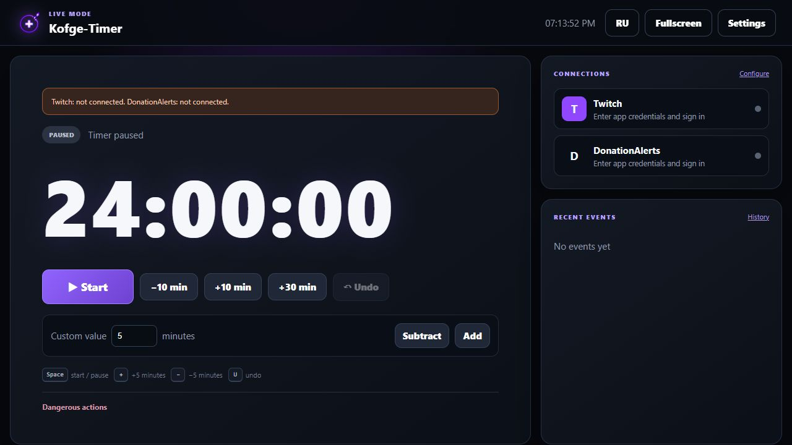

# Kofge-Timer

### A free stream marathon timer for Windows, OBS, Twitch and YouTube

Turn viewer support into more stream time. Kofge-Timer adds time for donations, Twitch subscriptions and Channel Points, or supported YouTube paid events — using rules you control.

**Free • No App Subscription • No License Keys • Local Control Panel • English & Russian • No Ads in the App or OBS**

*Live Mode with demonstration data. Streaming accounts are intentionally not connected in this screenshot.*

[Download](#download) • [Quick Start](#quick-start) • [Features](#features) • [YouTube Setup](#youtube-setup) • [Updates & Data](#updates--data) • [FAQ](#faq) • [Feedback](#feedback)

## Why Kofge-Timer?

- **Made for marathon streams and subathons.** Set your starting time and decide which events extend the stream.
- **Free to use.** No Kofge-Timer account, purchase, activation key or device limit. External services still require their own accounts and permissions.
- **Runs on your computer.** The Windows app serves a local browser control panel and an OBS overlay.
- **Your stream, your rules.** Configure time rewards, currency conversion, appearance and reusable profiles.
- **An uncluttered on-stream view.** Live Mode and an OBS dock keep the most useful controls close at hand.

## Download

### [Download Kofge-Timer for Windows](https://github.com/Kofge1/Kofge-Timer/releases/latest/download/Kofge-Timer-Offline.zip)

**Recommended file: `Kofge-Timer-Offline.zip`.** It includes the Windows x64 runtime, so you do not need to install Node.js separately. Extract the entire ZIP; do not move or run only the EXE without its accompanying files.

- Supported systems: **Windows 10 / Windows 11, x64**.
- [All releases and release notes](https://github.com/Kofge1/Kofge-Timer/releases).
- The smaller `Kofge-Timer.zip` does not include the runtime; choose the Offline ZIP if unsure.
- The `.zip.sig` file is the update signature manifest, not an installer.
- GitHub's **Source code (zip)** / **Download ZIP** contains repository files, not the ready-to-run application. Use the release download above.

> [!IMPORTANT]
> Download official builds from **Kofge1/Kofge-Timer** Releases. The word “Offline” means the runtime is bundled — Twitch, YouTube, donation services, exchange-rate refresh and update checks still require internet access.

## Quick Start

1. Download **Kofge-Timer-Offline.zip** and extract it into a folder you want to keep.
2. Launch **Kofge-Timer.exe**. The control panel opens in your browser. Windows may request administrator approval; check that you are launching your official download.
3. Open **Connections → Streaming platform** and select **Twitch** or **YouTube**. Follow the setup instructions for your chosen service.
4. Optionally connect **DonationAlerts**, **Streamlabs** or **StreamElements**. External donation services are configured separately from the streaming platform.
5. Open **Time Rules** to choose how much time each event adds. Use safe test events to check the calculation without changing your real timer.
6. Copy the **OBS URL** from the app. In OBS, add a **Browser Source** and paste that URL. A starting size of **1000 × 300** works for the overlay.
7. Set the starting time and press **Start**. Use **Live Mode** for a focused control view during your stream.

The default local addresses are:

| View | Default address |
| --- | --- |
| Control panel | `http://127.0.0.1:19191/` |
| OBS overlay | `http://127.0.0.1:19191/overlay` |
| Live Mode | `http://127.0.0.1:19191/live` |
| OBS control dock | `http://127.0.0.1:19191/dock` |

Use the URL copied from your app if its port differs. For the dock, open **OBS → View → Docks → Custom Browser Docks** and add the dock URL. The app must be running for the overlay and dock to work; optional Windows autostart is available in the timer settings.

## Features

### Twitch or YouTube

- Choose one active streaming platform without clearing the other platform's saved configuration.
- **Twitch:** subscriptions, gifted subscriptions, supported resubscription messages and up to **five selected Channel Points rewards**.
- **YouTube:** Super Chat, Super Stickers, new paid channel memberships and gifted membership bundles. See the setup and current limitations below.
- Separate time rules for platform events. Only the selected streaming platform adds time; external donation services remain independent.

### Donations and Currency

- **DonationAlerts**, **Streamlabs** and **StreamElements** integrations.
- Choose a main donation source, or disable external donation services when you do not need them.
- Base currency selection: **RUB, USD, EUR or CNY**.
- Manual conversion rates for incoming donations in other currencies.
- Optional, on-demand reference-rate refresh from the **Bank of Russia**. These are daily reference rates, not live market quotes or guaranteed payment-provider conversion rates.
- Full-step or proportional time calculation, with a safe preview before going live.

### Timer Controls

- Start, pause, add or subtract time, set an exact duration and undo an adjustment.
- Maximum duration and end-of-timer warning settings.
- Configurable automatic start when time is added and continuation after restart.
- Event history, connection status and setup readiness checks.
- Keyboard shortcuts in Live Mode: **Space**, **+**, **−** and **U**.

### Appearance and Everyday Use

- Customizable OBS overlay appearance and ready-made themes.
- A focused Live Mode and a compact OBS control dock.
- English and Russian interface, switchable inside the app.
- Settings autosave when values actually change.
- Reusable marathon profiles, local backups and restoration tools.

## YouTube Setup

YouTube support was added in **v0.1.34** and requires your own Google OAuth client.

1. Enable **YouTube Data API v3** in your Google Cloud project and configure the OAuth consent screen. If the app is in testing mode, add your Google account as a test user.
2. Create an OAuth client of type **Web application**. Add the callback URI shown by Kofge-Timer as an authorized redirect URI.
3. Enter the Client ID and Client Secret in the local **Connections** panel, wait for settings to save, then select **Connect YouTube**.
4. Sign in to the channel used for streaming. Start a live broadcast with chat enabled; if several broadcasts are active, specify the desired video ID in Kofge-Timer.
5. Configure membership time rewards and donation rules. Super Chat and Super Stickers use the donation amount/currency calculation.

> [!NOTE]
> YouTube events are polled at intervals of **at least 30 seconds**, subject to API quotas. Events from periods while disconnected are not recovered, and old chat history is not added when connecting. Free channel subscriptions, membership milestone messages and membership upgrades do not add time. Real Google sign-in and a monetized live-stream end-to-end test have not yet been completed; current automated checks use simulated API responses.

If a third-party donation service also forwards your YouTube payments, configure your sources to avoid counting the same payment twice.

## Updates & Data

Free-edition releases check for updates at startup and ask before installation. The updater verifies a **digital signature, SHA-256 hash and archive size** before applying an update, and creates an installation backup.

For a manual update:

1. Fully close Kofge-Timer using **Close** in the control panel.
2. Back up your existing **`data`** folder.
3. Replace the application files with the new release, keeping **`data`** intact.
4. Start **Kofge-Timer.exe** again.

Older paid/test builds using the former private update service need one manual migration to the free edition. Do not reset the timer or remove your data just to update the app.

### Privacy and Security

- Settings, timer state, integration credentials and backups are stored locally. Connected services receive the requests needed for their integrations.
- **Never publish your `data` folder, tokens, client secrets or unredacted logs.** Backups may also contain credentials.
- Update-manifest signatures are separate from Windows code signing. The EXE does not currently have a Windows publisher signature, so Windows may show an unknown-publisher warning.
- Network failures do not prevent manual use of the installed timer, but live integrations and updates depend on connectivity. Missed platform events may require checking history and adjusting time manually.
- The application and OBS overlay contain no advertising. Any planned advertising is for the public website only.

## FAQ

**Can I use the timer directly on the website without downloading it?**

No. The website presents the project and provides downloads. The timer is a local Windows app with a browser-based interface.

**Do I need Twitch and a donation platform together?**

No. Choose Twitch or YouTube for platform events, and connect an external donation service only if you need one. Manual timer controls can be used without connecting these accounts.

**Will I need to replace the OBS URL after restarting my PC?**

Not normally: the local URL stays the same when the app uses the same port. Start the app again, or enable its Windows autostart option.

**Where is the application in this repository?**

The `main` branch contains the public website and documentation. Ready-to-run application archives are distributed through [GitHub Releases](https://github.com/Kofge1/Kofge-Timer/releases). This repository is not currently a complete application-source checkout.

**Does it work offline?**

Manual controls and the local overlay work while the app is running. Online events, exchange-rate refresh and update downloads need an internet connection.

## Feedback

- Found a bug or have a feature idea? [Open an issue](https://github.com/Kofge1/Kofge-Timer/issues/new).
- Support and website advertising inquiries: [kofge.dev@gmail.com](mailto:kofge.dev@gmail.com).
- [Project website](https://kofge1.github.io/Kofge-Timer/) · [Release history](https://github.com/Kofge1/Kofge-Timer/releases).

For bug reports, include the app version, Windows version and steps to reproduce the problem. Remove credentials and personal details from screenshots and logs.

---

If Kofge-Timer helps your streams, consider starring the repository. It helps other streamers discover the project.
